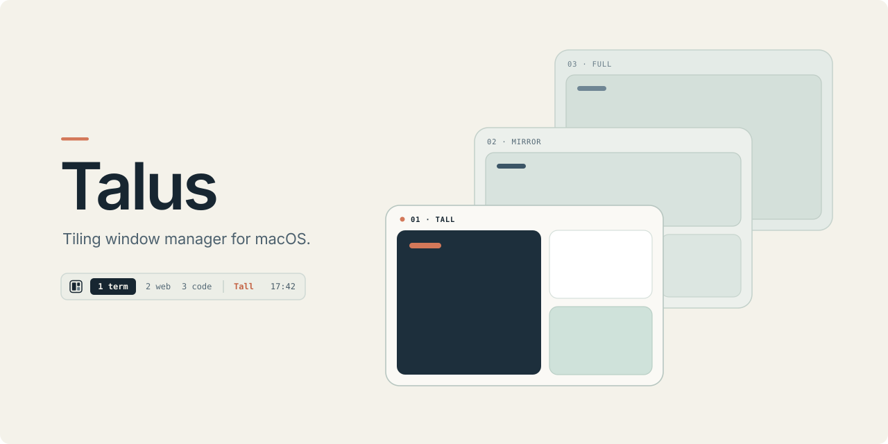
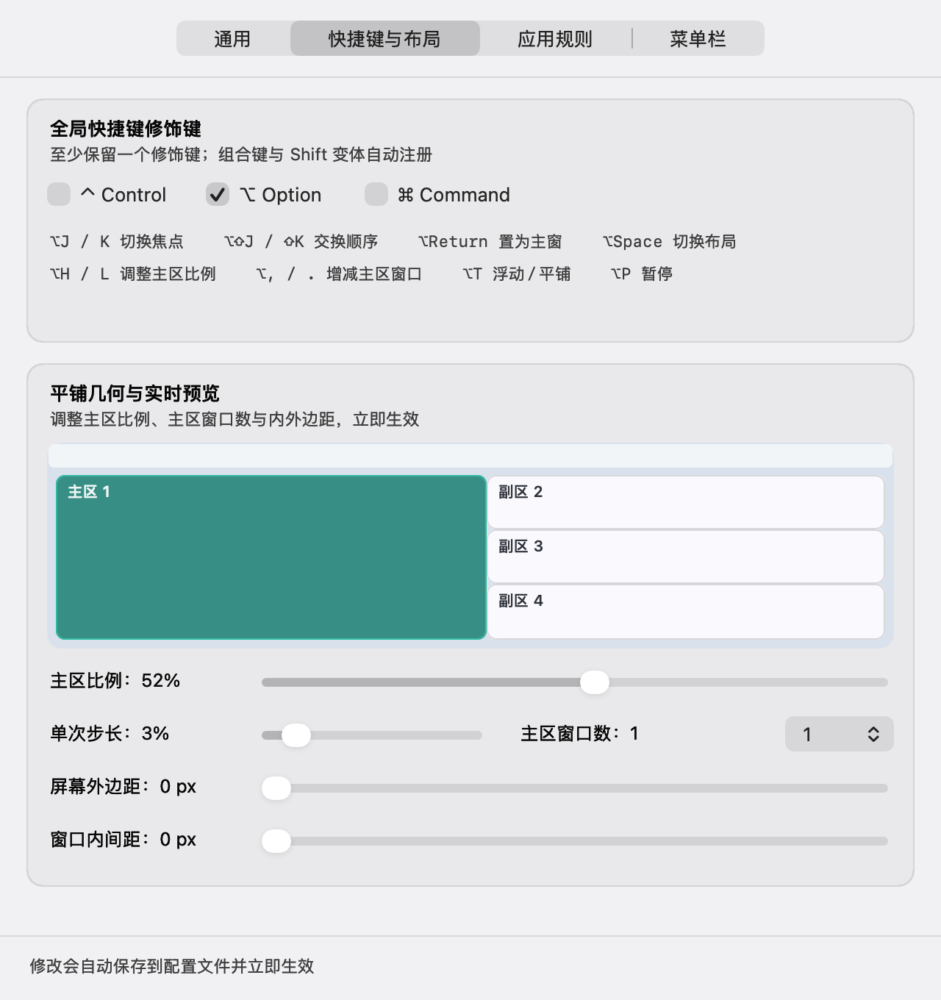
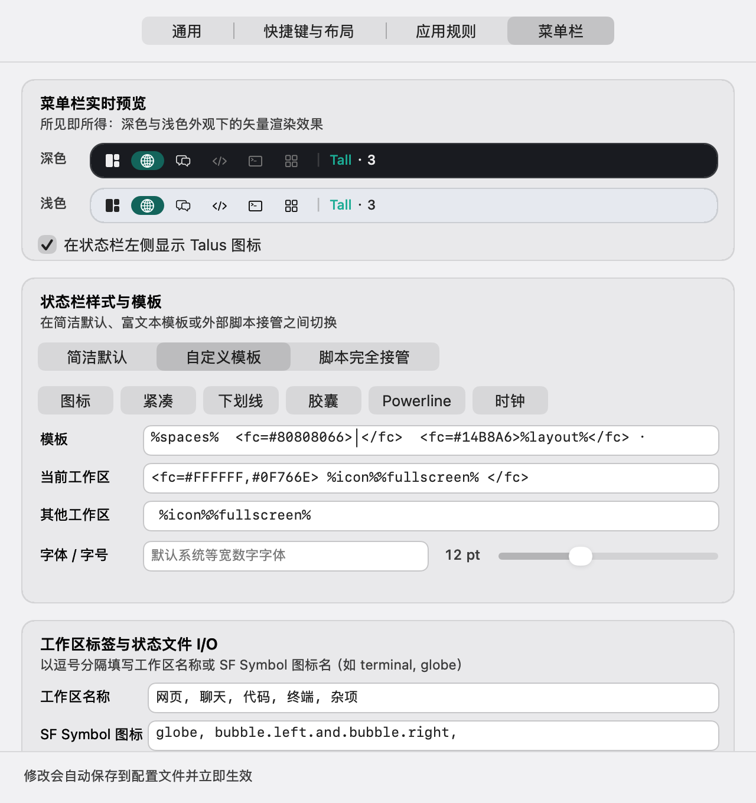

<p align="center">
  <picture>
    <source media="(prefers-color-scheme: dark)" srcset="docs/assets/hero-dark.svg">
    <source media="(prefers-color-scheme: light)" srcset="docs/assets/hero-light.svg">
    
  </picture>
</p>

<p align="center">
  <a href="docs/MANUAL.md">User Manual</a> ·
  <a href="docs/CONFIGURATION.md">Configuration</a> ·
  <a href="docs/STATUS_BAR.md">Status Bar</a> ·
  <a href="docs/ARCHITECTURE.md">Architecture</a> ·
  <a href="man/talus.1"><code>man talus(1)</code></a> ·
  <a href="https://github.com/nameoverflow/talus/releases">Releases</a>
</p>

---

**Talus** is an XMonad-inspired tiling window manager for **macOS 15+ (Apple Silicon)**—written in **100% pure [Geisha](https://github.com/geisha-lang/geisha.gsa)** using [`objc.gsa`](https://github.com/geisha-lang/objc.gsa), native AppKit, Accessibility (`AXUIElement`), Carbon hotkeys, and `SMAppService`. No X11, no SIP changes, no process injection, no Rust, and no Swift.

<sub>Named after the geological <em>talus</em> slope—interlocking stones resting at their natural angle of repose, settled cleanly with nothing forced out of place.</sub>

---

## Why Talus?

- **Deterministic Master-Stack Layouts**: `Tall`, `Mirror Tall`, and `Full` layouts with live-adjustable master ratio, master count, outer/inner gaps (0–64 pt), per-window float toggling, and automatic restoration of parked windows on pause or quit.
- **Native Spaces or Instant Virtual Workspaces**: Follow macOS Spaces (`mode = "native"`) or switch to Talus's zero-animation virtual workspaces (`mode = "virtual"`, 1–9) with 1px off-screen parking, per-workspace layout memory, atomic `0o600` session persistence, and click-to-switch menu-bar segments.
- **Per-App `Actor` Concurrency**: Each managed application PID owns a dedicated serial `std.actor` mailbox (`AppExecState`) for Accessibility discovery and geometry writes—parallel across applications, coalesced within each application, with `AXEnhancedUserInterface` animation suppression and read-back frame settlement (handling apps like Zen that acknowledge AX writes before moving).
- **Lag-Free Focus Delivery**: Queries the real frontmost process via dynamically loaded read-only `_SLPSGetFrontProcess` / `GetProcessPID` instead of stale `NSWorkspace` caches, uses minimal `AXMain` + `AXRaise` (+ `AXFrontmost` cross-app), waits for pending geometry barriers, and yields immediately to explicit pointer clicks.
- **xmobar-Style Menu Bar & Native Settings UI**: Rich `<fc>`, `<box>`, `<fn>`, and `<sf>` (SF Symbols) markup, isolated process-group async status commands with JSON state export, and a native AppKit Settings window (`⌘,`) that edits `~/.talus.toml` via `std.toml.patch` without losing your comments.

---

## Native Settings & Menu-Bar Preview

<table>
  <tr>
    <td width="50%">
      <picture>
        <source media="(prefers-color-scheme: dark)" srcset="docs/assets/settings-layout-dark.png">
        <source media="(prefers-color-scheme: light)" srcset="docs/assets/settings-layout-light.png">
        
      </picture>
      <p align="center"><sub><strong>Shortcuts &amp; Layout</strong> — Live tiling preview, modifiers, master ratio &amp; gaps</sub></p>
    </td>
    <td width="50%">
      <picture>
        <source media="(prefers-color-scheme: dark)" srcset="docs/assets/settings-status-dark.png">
        <source media="(prefers-color-scheme: light)" srcset="docs/assets/settings-status-light.png">
        
      </picture>
      <p align="center"><sub><strong>Menu Bar</strong> — Presets, markup templates, SF Symbols &amp; status commands</sub></p>
    </td>
  </tr>
</table>

---

## Quick Start

### 1. Download or Build

- **Prebuilt Apple Silicon app**: Download `Talus-macos-arm64.zip` from [GitHub Releases](https://github.com/nameoverflow/talus/releases), unzip, and move `Talus.app` to `/Applications`. (Ad-hoc signed, not notarized; allow on first launch via System Settings → Privacy & Security if prompted.)
- **Build from source** (requires macOS 15+, Xcode Command Line Tools, and [`geisha`](https://github.com/geisha-lang/geisha.gsa)):

```sh
git clone https://github.com/nameoverflow/talus.git
cd talus
make setup-cert   # one-time local code-signing cert so Accessibility permission survives rebuilds
make install      # builds build/Talus.app (minos 15.0), installs to /Applications/Talus.app, and launches
```

### 2. Grant Accessibility Permission

On first launch, macOS prompts for **Accessibility** access (**System Settings → Privacy & Security → Accessibility**). Enable `Talus` so it can read and arrange windows. No SIP disabling or Scripting Addition is required.

### 3. Configure (`~/.talus.toml` or `⌘,`)

Open the built-in Settings window from the menu bar (**设置…** / `⌘,`, or `Talus --settings`), or edit `~/.talus.toml` directly—changes hot-reload automatically (or press `⌘R` in the menu):

```toml
modifiers = ["control", "option"]

[workspaces]
mode = "virtual"
count = 5
labels = ["term", "web", "code", "chat", "misc"]

[layout]
master_ratio = 0.55
ratio_step = 0.03
master_count = 1
outer_gap = 10
inner_gap = 8

[rules]
ignore_apps = ["com.example.SomeApp"]

[rules.app_workspaces]
"com.apple.Terminal" = "term"
"com.apple.Safari" = "web"

[[rules.float_windows]]
app = "com.tencent.xinWeChat"
except_titles = ["微信", "WeChat"]

[status]
show_icon = true
template = "%spaces%  <fc=#89CFC2>%layout%</fc>  %clock%"
workspace_current = "<fc=#10201E,#89CFC2> %label%%fullscreen% </fc>"
workspace_other = "%label%%fullscreen%"

[[status.commands]]
name = "clock"
executable = "/bin/date"
arguments = ["+%H:%M"]
interval = 30
timeout = 2
```

---

## Default Keyboard Shortcuts

The default modifier chord `<Mod>` is `Control + Option` (`⌃⌥`), customizable via `modifiers` (`control`, `option`, `command`). `Shift` is reserved for swap/throw actions.

| Shortcut | Action |
| --- | --- |
| `<Mod> + J` / `<Mod> + K` | Focus next / previous window on the active screen |
| `<Mod> + Shift + J` / `K` | Swap focused window with next / previous window |
| `<Mod> + Return` | Swap focused window with master (or first stack window if already master) |
| `<Mod> + H` / `<Mod> + L` | Shrink / expand master pane width by `ratio_step` |
| `<Mod> + ,` / `<Mod> + .` | Increment / decrement number of windows in the master pane |
| `<Mod> + Space` | Cycle layout: `Tall` → `Mirror Tall` → `Full` |
| `<Mod> + T` | Toggle floating for the focused window |
| `<Mod> + P` | Pause / resume tiling (restores parked windows when paused) |
| `<Mod> + 1..9` | Switch to virtual workspace `1..count` (`mode = "virtual"`) |
| `<Mod> + Shift + 1..9` | Throw focused window to virtual workspace `1..count` (`mode = "virtual"`) |

> **Tip**: In `virtual` workspace mode, clicking any workspace segment in the menu bar switches directly to that workspace; right-clicking (or clicking the Talus icon / layout label) opens the menu.

---

## Documentation

| Document | Description |
| --- | --- |
| [**User Manual**](docs/MANUAL.md) | Installation, Accessibility & local signing, layouts, virtual workspaces, Launch at Login, CLI flags, environment variables, and troubleshooting |
| [**Configuration Reference**](docs/CONFIGURATION.md) | Complete normative reference for `~/.talus.toml`, path precedence, JSON migration, validation bounds, and rules recipes |
| [**Status Bar & Scripting Guide**](docs/STATUS_BAR.md) | Templates, `<fc>`/`<box>`/`<fn>`/`<sf>` markup grammar, async `[[status.commands]]`, `TALUS_STATUS_JSON`, `state_file`, and custom scripts |
| [**Architecture & Internals**](docs/ARCHITECTURE.md) | Pure Geisha core, per-PID `std.actor` concurrency, focus delivery, AX animation guard, `objc.gsa` ownership, and testing strategy |
| [**UNIX Man Pages (`man/`)**](man/talus.1) | Native BSD/macOS manual pages: `man/talus.1` (`talus(1)`) and `man/talus.toml.5` (`talus.toml(5)`) |
| [**Examples (`Examples/`)**](Examples/) | Ready-to-use `status-compact.toml`, `status-powerline.toml`, `status.py`, and `clock.hs` |

Install the UNIX man pages locally with `make install-man`, or preview them directly without installing:

```sh
man ./man/talus.1
man ./man/talus.toml.5
```

---

## Repository Structure

Talus is implemented end-to-end in Geisha (`src/`) with [`github.com/geisha-lang/objc.gsa`](https://github.com/geisha-lang/objc.gsa) locked in `geisha.lock`:

| Path | Responsibility |
| --- | --- |
| `src/layout.gsa` | Pure `Tall`, `Mirror Tall`, and `Full` geometry with outer/inner gaps and area conservation |
| `src/screen_geometry.gsa` | Multi-display coordinate transforms and 1px corner parking calculations |
| `src/window_stack.gsa`, `src/window_history.gsa` | XMonad-style circular focus/swap stack and MRU focus history |
| `src/virtual_workspaces.gsa`, `src/session_writer.gsa` | Virtual workspace state machine and coalesced `0o600` atomic session persistence |
| `src/config.gsa` | TOML/JSON decoding, strict validation, path resolution, and comment-preserving `std.toml.patch` writer |
| `src/status_markup.gsa`, `src/status_commands.gsa` | Template expansion, `<fc>/<box>/<fn>/<sf>` parser, pointer hit-testing, and `sys.proc` process-group command runner |
| `src/manager.gsa` | Pure `ManagerCore` state machine uniting layouts, rules, workspaces, focus guards, and keybindings |
| `src/macos/executor.gsa`, `src/macos/window_discovery.gsa` | Per-PID `Actor AppExecState` parallel AX discovery & coalesced geometry executor (`Send`-checked) |
| `src/macos/ax_io.gsa`, `src/macos/window_focus.gsa`, `src/macos/spaces.gsa` | AX geometry I/O with `AXEnhancedUserInterface` guard & read-back settle, `_SLPSGetFrontProcess` focus, SkyLight Spaces |
| `src/macos/appkit.gsa`, `src/macos/launch_at_login.gsa` | AppKit bridge, `SMAppService.mainApp` Login Item integration, and macOS FFI (`src/macos/ffi.gsa`) |
| `src/status_render.gsa`, `src/icon_gen.gsa`, `src/settings_ui.gsa` | Vector app/menu icons, rich `NSStatusItem` rendering, and native AppKit Settings window with live previews |
| `src/main.gsa` | Application bootstrap, Carbon hotkeys, AX observers, file-watch hot reload, and CLI entry points |

---

## Development & Verification

```sh
make check                           # Static typecheck (HM + exhaustiveness + Send)
make test                            # Builds Talus.app, verifies minos 15.0, runs all 3 Geisha test suites
make status-cleanup-test             # Verifies status subprocess process-group cleanup on exit
make integration-test                # Live desktop smoke test (requires unlocked desktop + Accessibility)
make launch-at-login-integration-test # Isolated SMAppService register/read/unregister probe
make settings-preview                # Renders 2x Retina dark/light Settings screenshots into build/settings-previews/
make dist                            # Builds clean ad-hoc signed build/Talus-macos.zip
```

GitHub Actions (`.github/workflows/release.yml`) bootstraps `geisha` on `macos-15`, verifies `make all test status-cleanup-test app CODESIGN_IDENTITY=-`, validates the packaged ZIP (`codesign --verify --deep --strict`, `lipo -archs = arm64`, bundle version), and publishes releases automatically on `vMAJOR.MINOR.PATCH` tags.
